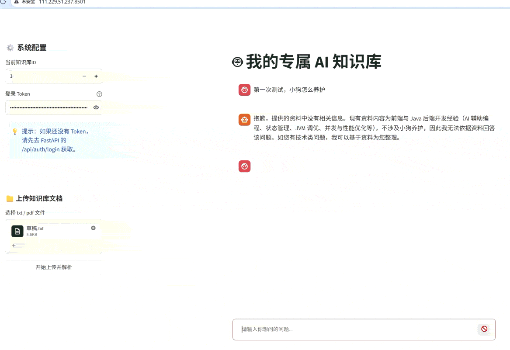
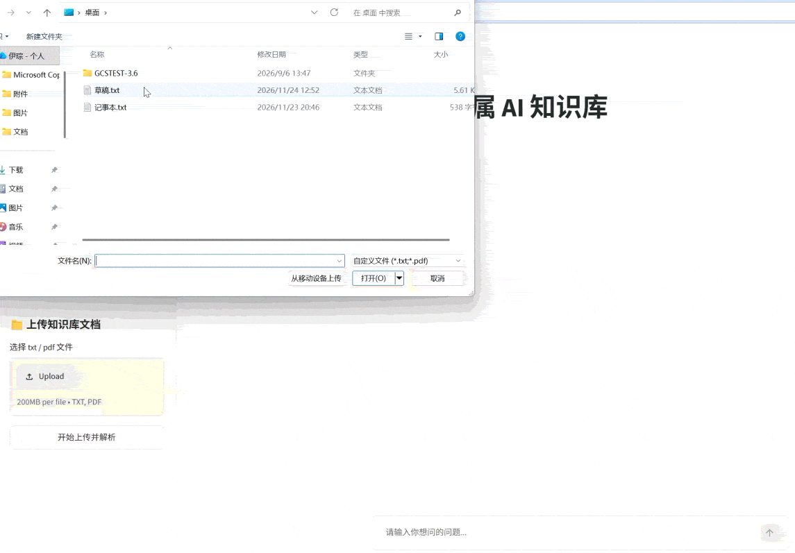

# 🧠 AI-SaaS-Platform (企业级 AI 知识库 SaaS 平台)

本项目是一个基于 **FastAPI + LangChain + Streamlit** 构建的完整企业级 AI SaaS 平台。从最初的基础分层脚手架，逐步演进为具备多租户隔离、异步任务队列、RAG 知识库检索以及流式对话的生产级应用。

## 🛠️ 核心技术栈

*   **Web 框架**: FastAPI (高性能异步 Web 框架)
*   **前端交互**: Streamlit (流式打字机输出、文件上传交互)
*   **数据校验**: Pydantic V2 (强类型校验与 DTO 转换)
*   **数据库 ORM**: SQLModel + SQLite (支持连接池与多租户数据隔离)
*   **大模型生态**: LangChain + DeepSeek API (支持 Agent 工具调用、带记忆的对话)
*   **向量检索 (RAG)**: Redis Stack (支持向量存储与相似度检索) + DashScope Embeddings
*   **异步任务**: Celery + Redis (处理文档解析与向量化，拒绝前端阻塞)
*   **容器化部署**: Docker + Docker Compose (多容器一键编排、健康检查、自动重启)

## 🏗️ 项目架构概览

采用标准的微服务分层架构，严格区分职责：

```text
ai-saas-platform/
├── core/                 # 核心配置层
│   ├── RAG/              # RAG 核心逻辑 (Celery 配置、异步任务)
│   ├── config.py         # Pydantic-settings 全局环境变量配置
│   ├── exceptions.py     # 全局异常拦截，统一 JSON 返回格式
│   ├── middlewares.py    # 跨域与请求日志中间件
│   └── response.py       # 统一响应模型
├── crud/                 # 数据访问层 (基于泛型的通用 CRUD 封装)
├── db/                   # 数据库与会话引擎配置
├── dependencies/         # 全局依赖注入 (JWT 鉴权守卫)
├── models/               # 数据库实体 (User, KB, ChatMessage 等)
├── routers/              # API 路由层 (Auth, User, KB, Chat)
├── schemas/              # DTO 数据校验模型
├── tests/                # Pytest 自动化测试 (100% 接口覆盖率)
├── ui.py                 # Streamlit 前端交互页面
├── Dockerfile            # 生产级镜像构建脚本
├── docker-compose.yml    # 多容器一键编排 (Redis, Backend, Worker, Frontend)
└── requirements.txt      # 生产环境依赖清单

✨ 核心功能亮点
多租户物理隔离的 RAG：用户上传的文档经过异步切分后，会存入以 kb_index_{kb_id} 命名的独立 Redis 索引中，彻底杜绝数据串台。

Celery 异步处理管道：大文件上传后即刻返回 task_id，后台 Celery Worker 默默进行文档解析、分块与向量化，前端通过轮询实时展示解析进度。

基于 SSE 的流式对话：支持打字机效果的 AI 回复，并在流式输出的同时，将用户提问和 AI 完整回答落库保存。

Agent 工具调用：大模型具备自主思考能力，可根据用户提问自主决定是否调用外部 API（如高德地图天气查询）。

生产级容器编排：通过 docker-compose 编排 4 个独立容器，并配置 healthcheck 与 restart: always，实现故障自愈与服务自启。

🚀 快速启动 (Docker 部署)
1. 克隆代码并配置环境变量：

bash
git clone <你的仓库地址>
cd ai-saas-platform
# 复制并填写你的真实 API Key
cp .env.example .env 
nano .env
2. 一键构建并启动所有服务：

bash
sudo docker compose up -d --build
3. 访问应用：

前端交互界面: http://<服务器公网IP>:8501

后端 API 文档: http://<服务器公网IP>:8000/docs

🗺️ 未来演进路线 (Roadmap)
□ 引入 LangGraph 构建具备自我反思、循环决策能力的复杂 Agent 工作流。
□ 将 SQLite 替换为 PostgreSQL，提升高并发下的数据库性能。
□ 接入 Rerank 模型（如 BGE-Reranker），提升 RAG 的召回准确率。
□ 支持更多文档格式解析（PDF 表格、图片多模态识别）。
⭐ 如果觉得这个架构对你有帮助，欢迎点个 Star！


